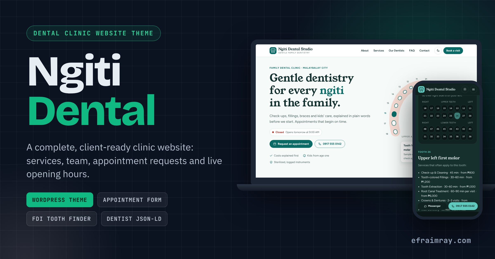

# Ngiti Dental — WordPress Theme for Clinics

A complete, client-ready WordPress theme for dental clinics and other professional practices in the Philippines: services, team, appointment requests, live opening hours and a tooth-chart service finder.

[](CHANGELOG.md)
[](readme.txt)
[](readme.txt)
[](LICENSE)
[](assets/js/theme.js)



**Live demo:** https://efraimray.github.io/ngiti-dental-theme/demo/ (static export of the theme; forms are simulated)

> New here? Read [docs/BUILD-LOG.md](docs/BUILD-LOG.md) for the languages used and how this was built.

## Features

- **Nine page templates**: Home, About, Services & Fees, Our Dentists, Appointment Request, Patient FAQ, Contact & Directions, Privacy Notice (Data Privacy Act, RA 10173) and Disclaimer, plus default page, single, index and 404.
- **Custom post types**: Services (duration, starting price in ₱, icon, tooth groups), Team members (role, credentials, initials avatar) and private Appointment requests with reference numbers.
- **Appointment request and contact forms** handled by the theme: nonce, honeypot, 60-second rate limit, sanitizing, PH mobile validation (`0917…` or `+63…`), closed-day check, saved request post, `wp_mail()` notice and a Post/Redirect/Get success page.
- **Clinic details in the Customizer**: phone, Messenger, emails, address, map link and hours for weekdays, Saturday and Sunday. Used everywhere, including the sticky call/Messenger buttons.
- **Live "Open now" badge** that is computed in the visitor's browser, so it stays right on cached pages (lunch breaks and "Opens Monday at 9:00 AM" included).
- **FDI tooth finder**: tap a tooth on the dentist's chart and see its name plus the services that usually apply.
- **SEO**: Dentist (LocalBusiness) JSON-LD with opening hours, meta descriptions and Open Graph tags; it steps aside when Yoast, Rank Math, AIOSEO, SEOPress or The SEO Framework is active.
- **Design system**: CSS custom properties, type scale, light and dark themes, skip link, focus states, responsive to 360 px, self-hosted fonts, zero external requests.
- **One-click sample content**: pages with their templates, eight services, four team members and both menus.

## Tech Stack

| Layer | What |
|---|---|
| Platform | WordPress 6.3+ classic theme (Customizer API, custom post types, admin-post handler, shortcodes) |
| Server | PHP 7.4+ (tested on PHP 8.3 with WordPress 6.5.5) |
| Front end | CSS custom properties, vanilla JavaScript (no jQuery, no build step) |
| Data | `inc/sample-content.json` shared by the importer and the static export |
| Tooling | Python 3 (static export, arch illustration), Playwright tests, WP-CLI `i18n make-pot` |

## Folder Structure

```
ngiti-dental-theme/
├── style.css                 Theme header
├── functions.php             Setup, assets, includes
├── header.php / footer.php   Shared header (menu, toggle) and footer (hours, contact, sticky buttons)
├── front-page.php            Home page
├── page.php, single.php, index.php, 404.php
├── page-templates/           About, Services, Team, Appointment, FAQ, Contact, Privacy, Disclaimer
├── template-parts/           CTA band, visit steps, tooth finder, hero arch SVG
├── inc/
│   ├── template-tags.php     Clinic options, hours, icons, cards, logo
│   ├── customizer.php        Clinic details section
│   ├── post-types.php        Services, Team, Requests + meta boxes
│   ├── appointment-form.php  Form markup, shortcodes and the secure handler
│   ├── seo.php               Meta, Open Graph, Dentist JSON-LD, favicon
│   ├── sample-content.php    One-click importer
│   └── sample-content.json   Sample clinic, services, team, FAQ, page texts
├── assets/css, assets/js, assets/fonts, assets/img
├── languages/ngiti-dental-theme.pot
├── demo/                     Static HTML export (GitHub Pages)
├── tools/                    export-static.py, arch_svg.py
├── tests/site.test.js        Playwright end-to-end checks
├── docs/                     BUILD-LOG, TUTORIAL, DEPLOYMENT
└── publish-to-github.bat/.ps1
```

## Quick Start / Installation

1. Download `ngiti-dental-theme.zip` from the [latest release](https://github.com/EfraimRay/ngiti-dental-theme/releases).
2. wp-admin → **Appearance → Themes → Add New → Upload Theme** → choose the zip → **Install Now** → **Activate**.
3. Click **Create sample content** in the blue notice.
4. **Appearance → Customize → Clinic details**: enter the real phone, address, Messenger link and hours.
5. Edit **Services** and **Team** in the admin menu; add team photos as featured images.

## Usage

- Put the forms anywhere with `[ngiti_appointment_form]` or `[ngiti_contact_form]`.
- New requests appear under **Requests** in wp-admin and are emailed to the "Send appointment requests to" address.
- Use the hook `ngiti_request_received( $ref, $lines, $type )` to send requests to SMS, Google Sheets or a CRM.

## Configuration

| Where | Setting |
|---|---|
| Customize → Clinic details | Phone, Messenger, public email, request email, address, city, map link, hours, social links |
| Customize → Site Identity | Logo (replaces the SVG monogram), site title, tagline, site icon |
| Appearance → Menus | Primary and Footer menus |
| Filters | `ngiti_week`, `ngiti_faq`, `ngiti_schema`, `ngiti_output_schema`, `ngiti_seo_plugin_active` |

Hours use 24-hour ranges separated by commas, for example `09:00-12:00,13:00-17:00`. Leave a day empty to mark it closed.

## Deployment

On Windows, double-click **publish-to-github.bat**: it creates the repository, pushes, tags the release with the installable zip and turns on GitHub Pages. See [docs/DEPLOYMENT.md](docs/DEPLOYMENT.md) for GitHub Desktop, git CLI, shared hosting and form delivery.

## Customization (rebranding for a real client)

1. **Name and logo**: Settings → General (site title) and Customize → Site Identity (upload the clinic logo).
2. **Colours**: edit the tokens at the top of `assets/css/main.css` (`--brand`, `--blush`, `--paper`, and the dark set below).
3. **Content**: replace the sample services, prices, team and page texts; remove the "Sample" notes.
4. **Contact details and hours**: Customize → Clinic details.
5. **Photos**: add team photos as featured images; they replace the initials avatars.
6. **Legal pages**: have the Privacy Notice and Disclaimer reviewed for the real clinic.
7. **Other professions**: the same templates fit a veterinary clinic, physical therapy clinic or law office; change the wording, the schema `@type` (filter `ngiti_schema`) and hide the tooth finder.

## Roadmap

- Real-time slot picker that reads the clinic's booked times.
- Tagalog and Cebuano translations.
- Holiday closures in the hours table and the open-now badge.
- A block pattern library for the front-page sections.

## Contributing

Issues and pull requests are welcome. Run `php -l` on changed PHP files and `node tests/site.test.js` against a local install before opening a PR.

## Requesting improvements

Open an issue and add the label **`claude-improve`**. The nightly showcase run picks up to two of these, implements them, bumps the version and ships an updated zip.

## License

GPL-2.0-or-later. See [LICENSE](LICENSE). Fonts: SIL Open Font License 1.1. All clinic names, people, credentials and prices in the sample content are fictional.

## Author

**Efraim Ray** — web developer and AI automation specialist, Valencia City, Bukidnon — https://www.efraimray.com/
